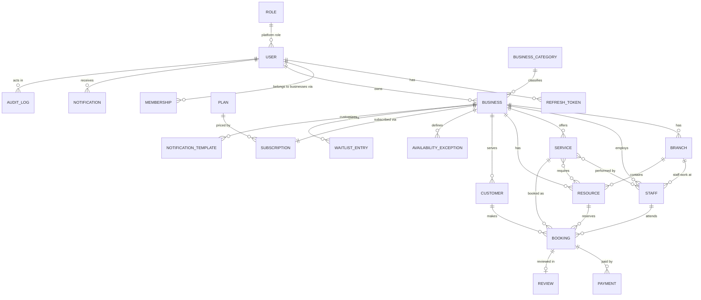

# Database ERD (MongoDB)

All tenant collections carry `business` (ObjectId) and every compound index starts with it.
Times are stored in UTC `Date`; local times-of-day (`"09:00"`) are interpreted in the branch /
business IANA timezone.

## Collections

| Collection | Key fields | Indexes |
|-----------|-----------|---------|
| `users` | email (unique, lowercased), passwordHash, name, phone, role, memberships[{business, role, staff}], favorites[business], locale, avatar, status, lastLoginAt | `email` unique, `memberships.business` |
| `roles` | key, name, permissions[] (platform + business role definitions; seeded, editable by admin) | `key` unique |
| `refreshtokens` | user, tokenHash, family, revokedAt, expiresAt, userAgent, ip | `tokenHash` unique, TTL on `expiresAt` |
| `businesscategories` | slug, name{en,ar}, description{en,ar}, icon, color, terminology{staff,service,resource}{en,ar}, bookingFlow{steps[], requireStaff, resourceFirst, sessionModes[], customFields[]}, isActive, sortOrder | `slug` unique |
| `businesses` | owner, category, name, slug, tagline, description, logo, cover, gallery[], branding{primaryColor, accentColor, customDomain}, contact{email, phone, website, whatsapp}, address{line1, city, country, location: GeoJSON Point}, timezone, currency, locale, settings{slotInterval, minNoticeMinutes, maxAdvanceDays, requireApproval, allowGuestBooking, payment{mode, depositPercent, acceptCash}, cancellation{allowed, cutoffHours, feePercent}, reschedule{allowed, cutoffHours, maxTimes}, notifications{email, whatsapp, sms, reminderHours[]}}, status, featured, rating{average, count}, priceRange{min,max}, invoiceSeq | `slug` unique, `address.location` 2dsphere, text(name, tagline, description), `{category, status}`, `{status, featured}` |
| `branches` | business, name, address, location, timezone, phone, workingHours (WeeklySchedule), isActive | `{business, isActive}`, `location` 2dsphere |
| `staff` | business, user?, name, title, bio, avatar, email, phone, color, branches[], services[], workingHours (WeeklySchedule), acceptsBookings, isActive, rating | `{business, isActive}`, `{business, user}` |
| `services` | business, name, description, group, image, duration, bufferBefore, bufferAfter, price, depositPercent?, capacity, staff[], branches[], resources[], sessionModes[], requiresApproval?, customFields[], color, isActive, sortOrder | `{business, isActive}`, text(name, description) |
| `resources` | business, branch, name, type, capacity, description, isActive | `{business, branch}` |
| `availabilityexceptions` | business, scope(business/branch/staff/resource), ref, start, end, kind(closed/open), reason | `{business, scope, ref, start}` |
| `customers` | business, user?, name, email, phone, notes, tags[], stats{bookings, completed, cancelled, noShows, totalSpent, lastVisitAt} | `{business, email}` unique, `{business, user}` |
| `bookings` | business, branch, service, staff, resource, customer, user?, reference, start, end, timezone, attendees, status, mode, source, answers, customerNote, internalNotes, price{amount, currency, deposit, paid, status, method}, recurrence{groupId, index, rule}, rescheduleCount, cancellation{by, reason, at, fee}, history[], reminderSentAt, reviewRequestedAt, slotKey | `reference` unique, `slotKey` unique sparse, `{business, start}`, `{business, staff, start}`, `{business, resource, start}`, `{business, customer}`, `{user, start}`, `{status, start}` |
| `waitlistentries` | business, service, staff?, date, name, email, phone, user?, status, notifiedAt | `{business, date, status}` |
| `payments` | business, booking, customer, amount, currency, kind(deposit/full/balance/refund), method(online/cash), provider, providerRef, status, invoiceNumber, paidAt | `{business, createdAt}`, `{booking}`, `providerRef` |
| `plans` | key, name, description, price{monthly, annual}, currency, limits{staff, branches, bookingsPerMonth, customBranding, integrations, ai, advancedAnalytics, whatsapp}, features[], isActive, sortOrder, highlighted | `key` unique |
| `subscriptions` | business (unique), plan, interval, status, currentPeriodStart/End, cancelAtPeriodEnd, provider, providerRef | `business` unique |
| `reviews` | business, booking (unique), user, customer, staff, rating, comment, reply{text, at}, status | `{business, createdAt}`, `booking` unique |
| `notifications` | user, business?, event, title, body, link, readAt, channel | `{user, readAt, createdAt}` |
| `notificationtemplates` | business? (null = global), event, channel, locale, subject, body, isActive | `{business, event, channel, locale}` unique |
| `auditlogs` | actor, business?, action, entity, entityId, meta, ip | `{business, createdAt}`, `{actor, createdAt}`, TTL 400 days |
| `platformsettings` | key (singleton "global"), platformName, supportEmail, defaultCurrency, defaultLocale, maintenanceMode, allowBusinessSignup, commissionPercent | `key` unique |

### Embedded schemas
* **WeeklySchedule** = `[{ day: 0-6, enabled, intervals: [{start:"09:00", end:"13:00"}] }]` — breaks are the gaps between intervals.
* **CustomField** = `{ key, label{en,ar}, type, required, options[], placeholder }`.
* **BookingPolicy** = `Business.settings.cancellation | reschedule | payment`.

### Tenant isolation rules
1. Tenant routers use `mergeParams` and read `req.tenant.business._id`, never `req.body.business`.
2. Every query in tenant services includes `{ business: tenantId }`; IDs coming from the client
   (service, staff, branch) are re-validated to belong to the same business.
3. Customers only see bookings where `user = me`; guests need reference **and** email.
